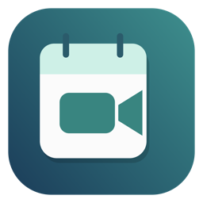

# Calendar Meet

Native macOS Swift app and EventKit virtual conference extension adding **Google
Meet** to Apple Calendar's **Add Location or Video Call** picker.

## 0.4.0 — create Meet on the actual Google Calendar event

Keep creating events in Apple Calendar and manually choose Google Meet. The
extension now inserts a unique local `calendarmeet://pending/...` setup link.
After the event is saved and synced, the menu-bar app finds that exact marker in
writable Google calendars and requests a native `hangoutsMeet` conference on the
existing Google event ID with `conferenceDataVersion=1`. It never inserts another
event and no longer calls Meet `spaces.create`.

A reconnect is required for Calendar event read/write and calendar-list read
permissions. Enable Google Calendar API in the team's Google Cloud project.
The minimal menu-bar UI, original icon, no Dock icon, Launch at Login default on,
and right-click Quit are retained. No signing notices are shown in the app.

Meet becomes available **after saving and syncing**, not while editing an unsaved
draft. Google Calendar then syncs its native conference back to Apple Calendar.
Normal guest invitation/update emails remain enabled. The special meeting-code
replacement mail was not observed in the live 0.4.0 tests; Google still controls
its notifications. Apple still owns the visible Open/Join label.

Only explicitly marked, unambiguous events organized by the connected account
are modified. ETags protect concurrent edits, stable request IDs prevent duplicate
creation, and unrelated fields are preserved. Existing conferences are never
overwritten. Recurring series are supported as a whole; recurring exceptions are
rejected. iCloud/Exchange events are not processed. Pending requests survive app
restart, expire after 24 hours, and are never matched by title/date guesses.

See [design](docs/DIRECT-CALENDAR.md) and [verification](docs/VERIFICATION.md).



## Build

```sh
bash Scripts/test.sh
GOOGLE_CLIENT_JSON=/absolute/path/DesktopClient.json bash Scripts/build.sh
bash Scripts/package.sh
```

Without `GOOGLE_CLIENT_JSON`, the app prompts to import the team's Desktop OAuth
file. Do not commit client exports, tokens, certificates or local configuration.
The local Google client supplied during setup is deliberately not in this repo.
GitHub's generic prerelease requires import. The signed workflow supports an
optional CI client configuration. Local client-bundled installers can be shared directly.

Universal arm64 + x86_64, macOS 13+. No third-party libraries or project generator.
Both targets remain sandboxed. No macOS Calendar, contacts, camera or microphone permission is requested.
The app requests `calendar.events` and `calendar.calendarlist.readonly`. PKCE S256, random
OAuth state, loopback-only callbacks, deadlines, cancellation, refresh and revocation
are implemented. Tokens and API response bodies are not logged.

[Google setup, optional signing and troubleshooting](docs/SETUP.md).
Optional Developer ID signing/notarization remains available for easier installation;
it is no longer required for shared OAuth storage because no storage is shared.

## Platform references

- [Apple virtual conference extension](https://developer.apple.com/documentation/eventkit/implementing-a-virtual-conference-extension)
- [Apple NSWorkspace explicit app opening](https://developer.apple.com/documentation/appkit/nsworkspace)
- [Apple macOS Keychain implementations](https://developer.apple.com/documentation/technotes/tn3137-on-mac-keychains)
- [Google Desktop OAuth](https://developers.google.com/identity/protocols/oauth2/native-app)
- [Google Meet spaces.create](https://developers.google.com/workspace/meet/api/reference/rest/v2/spaces/create)

EventKit provider APIs are public since macOS 12; this SwiftUI app targets macOS 13.
No UI scripting or Calendar database access is used by the app. Original icon in
Scripts/Icon.swift. Independent utility, not affiliated with Apple or Google. MIT.
